# Đặc tả dự án Ai Lạc Quẻ?

Ngày đối chiếu: **13/11/2026**. Mốc nền: **7b22962**, cập nhật thêm bản sửa Vercel → Cloudflare D1 trong workspace.

**Cấu hình triển khai hiện tại:** xem [KET_NOI_CLOUDFLARE_D1.md](KET_NOI_CLOUDFLARE_D1.md). Bản sửa thay RAM fallback production bằng Worker/D1, cập nhật kiểm soát phiên bản và sửa sinh mã phòng.

Tài liệu mô tả phiên bản đang có trong repository, không phải danh sách tính năng dự kiến. Khi có khác biệt, ưu tiên mã nguồn hơn README cũ. UI được mô tả từ JSX/CSS; chưa xác minh bằng trình duyệt trong đợt lập tài liệu này.

## 1. Tra cứu nhanh

| Cần tìm hoặc sửa | Nguồn chính |
| --- | --- |
| Màn hình, biểu mẫu, phiên chơi, polling | [app/page.tsx](../app/page.tsx) |
| Màu sắc, bố cục, responsive | [app/globals.css](../app/globals.css) |
| Metadata, tiếng Việt, favicon | [app/layout.tsx](../app/layout.tsx), [favicon.svg](../public/favicon.svg) |
| Luật chơi, chuyển lượt, tính điểm, dữ liệu công khai | [lib/game.mjs](../lib/game.mjs) |
| Từ khóa, phân độ khó, chuẩn hóa đáp án | [lib/word-bank.mjs](../lib/word-bank.mjs) |
| API tạo/vào phòng và thao tác | [app/api/rooms/route.ts](../app/api/rooms/route.ts) |
| Chọn storage theo runtime | [lib/storage-context.mjs](../lib/storage-context.mjs) |
| Lưu RAM chỉ cho dev | [lib/room-store.mjs](../lib/room-store.mjs) |
| Vercel gọi storage Worker | [lib/remote-room-store.mjs](../lib/remote-room-store.mjs) |
| Worker lưu D1 bằng SQL nguyên tử | [worker/room-storage.mjs](../worker/room-storage.mjs) |
| Schema và kết nối D1 | [db/schema.ts](../db/schema.ts), [db/index.ts](../db/index.ts) |
| Lệnh chạy hiện hành | [package.json](../package.json), [vercel.json](../vercel.json) |
| Đường chạy Cloudflare/Vinext | [vite.config.ts](../vite.config.ts), [worker/index.ts](../worker/index.ts) |
| Kiểm thử đang có | [tests/room-store.test.mjs](../tests/room-store.test.mjs) |

Đọc mục 2–6 để nắm sản phẩm; mục 7–10 để sửa backend hoặc triển khai; mục 11 để biết các điểm chưa bảo đảm. Danh mục file: [BAN_DO_MA_NGUON.md](BAN_DO_MA_NGUON.md).

## 2. Sản phẩm và phạm vi

Game suy luận xã hội bằng tiếng Việt cho **3–5 người** trên trình duyệt. Người chơi dùng biệt danh, tạo phòng hoặc vào phòng bằng mã/link. Mỗi ván có một người nhận từ khác với cả nhóm, đưa gợi ý kín qua hai lượt, bỏ phiếu và có thể đoán từ để lật kèo. Điểm cộng dồn trong phòng, không có giới hạn số ván hoặc đích điểm kết thúc tự động.

Trang chính duy nhất là `/`; link mời có dạng `/?room=ABCDE`. Các giai đoạn là trạng thái trong cùng trang, không phải các route riêng. Không có bot, chat tự do, âm thanh, khán giả, ghép trận công khai, tài khoản game hay bảng xếp hạng liên phòng trong luồng hiện tại. Thư viện đăng nhập ChatGPT/connector có trong starter nhưng game không gọi chúng.

## 3. Sơ đồ kiến trúc

```mermaid
flowchart TD
  Browser[Trình duyệt: app/page.tsx] -->|GET status / POST action| API[/api/rooms]
  Browser --> Session[sessionStorage: alq-session]
  Browser --> Name[localStorage: alq-name]
  API --> Engine[lib/game.mjs: act, advance, snapshot]
  Engine --> Words[lib/word-bank.mjs]
  API --> Store[lib/storage-context.mjs]
  Store -->|Vercel: HTTPS có secret| Gateway[Worker room-storage]
  Gateway --> DB[Cloudflare D1: rooms]
  Store -->|Native binding khi app chạy Worker| DB
  Store -->|Chỉ dev không cấu hình DB| RAM[Map trong tiến trình]
  Engine -->|Snapshot riêng theo người chơi| Browser
```

Stack khai báo: Next.js 16.3.4, React 19.2.6, TypeScript 5.9.3, ESM `.mjs`; Drizzle ORM 0.45.2; Vinext 1.0.0-beta.5, Vite 8.0.13 và Wrangler 4.92.0 cho đường Cloudflare. Đây là phiên bản trong manifest, không phải khẳng định phiên bản mới nhất.

Game dùng HTML, SVG inline và CSS riêng. Bộ `components/ui` là thư viện shadcn/Radix/Base UI được mang theo starter; `app/page.tsx` không import bộ đó. Không nên suy ra rằng các component chat, chart, calendar có mặt trên màn hình game.

## 4. Sơ đồ gameplay

```mermaid
stateDiagram-v2
  [*] --> lobby: Tạo phòng
  lobby --> clue1: Chủ phòng start; đủ 3–5 người
  clue1 --> clue2: Đủ gợi ý hoặc hết 45 giây
  clue2 --> vote: Đủ gợi ý hoặc hết 40 giây
  vote --> rescue: Lạc quẻ đứng đầu phiếu một mình
  vote --> result: Chọn sai / hòa / không có phiếu
  rescue --> result: Đoán một lần hoặc hết 20 giây
  result --> clue1: Chủ phòng mở ván mới
  clue1 --> lobby: Một người rời phòng
  clue2 --> lobby: Một người rời phòng
  vote --> lobby: Một người rời phòng
  rescue --> lobby: Một người rời phòng
  lobby --> [*]: Người cuối rời phòng
  result --> [*]: Người cuối rời phòng
```



`clue1` và `clue2` trong sơ đồ đều là `phase="clue"`, phân biệt bằng `clueStage=1|2`. Bỏ phiếu kéo dài **35 giây**. Tổng thời gian danh nghĩa tối đa các lượt là **140 giây** nếu có lật kèo, hoặc **120 giây** nếu không; không tính chờ và độ trễ mạng.

Máy chủ không chạy timer nền: `advance(room, now)` được gọi khi nhận request. Nếu không ai gửi request, trạng thái chưa được lưu sang giai đoạn kế tiếp. Deadline mới tính từ lúc xử lý chuyển giai đoạn, nên không được hiểu thời lượng trên là giới hạn tuyệt đối theo đồng hồ thực.

### 4.1. Phòng và người chơi

- Tạo phòng đưa người tạo vào và gán làm chủ phòng. Ban đầu `round=0`, `phase=lobby`, `difficulty=mixed`.
- Tên được trim, gộp khoảng trắng, cắt tối đa 20 ký tự; không rỗng, không trùng tên trong phòng khi so sánh chữ thường. Không bỏ dấu khi kiểm tra trùng tên.
- Tối đa 5 người; chỉ được vào thêm ở `lobby` hoặc `result`.
- Mỗi người có UUID `id`, UUID `token`, màu 0–4 chưa được dùng và điểm ban đầu 0.
- Chỉ chủ phòng đổi độ khó hoặc bắt đầu ván, chỉ ở `lobby/result`; cần ít nhất 3 người để bắt đầu.
- Chủ phòng rời thì người đầu còn lại trong danh sách nhận quyền. Rời ở giai đoạn chơi làm dừng ván, về lobby, không cộng điểm ván bị hủy.
- Người cuối rời thì API xóa phòng. Đóng tab không tự gửi `leave`; không có cơ chế kick do mất kết nối.
- Vào lại bằng tên sau khi mất token là người chơi mới, không tự phục hồi danh tính/điểm cũ; tên còn trong phòng có thể bị báo trùng.

### 4.2. Phát từ và phân vai

Mỗi ván chọn một cặp chưa dùng trong độ khó hiện hành; nếu có thể thì tránh cả những từ đã xuất hiện ngay ván trước. Hết pool mới bỏ lịch sử cặp của pool đó để dùng lại. Hai từ được đảo thứ tự ngẫu nhiên: `words[0]` của nhóm, `words[1]` của người lạc quẻ.

Người lạc quẻ không trùng người lạc quẻ ngay ván trước nếu người đó vẫn trong phòng. Trong số còn lại, trọng số là `1 / (1 + oddTurns[id])`; đây là ưu tiên người ít nhận vai hơn, không phải cam kết chia đều tuyệt đối. Chọn cặp/vai dùng `Math.random`; token/id dùng `crypto.randomUUID`.

### 4.3. Hai lượt gợi ý

| Lượt | Thời gian | Giới hạn | Hiển thị |
| --- | --- | --- | --- |
| 1 | 45 giây | Tối đa 3 từ | Gợi ý cùng lượt kín đến khi chuyển lượt |
| 2 | 40 giây | Tối đa 12 từ | Thấy lượt 1; lượt 2 kín đến khi bỏ phiếu |

Mọi người gửi song song, mỗi người một gợi ý/lượt. Server trim, gộp khoảng trắng, cắt 70 ký tự rồi kiểm tra; bộ đếm từ dựa trên chuỗi chuẩn hóa tách theo khoảng trắng, không phải phân tích từ vựng tiếng Việt. Gợi ý phải có chữ/số, đúng `round` và `stage`, không trùng gợi ý lượt trước sau chuẩn hóa, không chứa nguyên từ bí mật của chính người gửi. Với từ nhiều tiếng còn kiểm tra dạng bỏ khoảng trắng. Đây không phải bộ lọc mọi cách ám chỉ hoặc mọi từ của đối thủ.

Khi tất cả gửi xong, lượt có thể kết thúc sớm. Người không gửi trước deadline được bỏ qua, không tạo gợi ý tự động. Snapshot chỉ gửi số người đã nộp và cờ `sentClue` ở lượt đang kín, không gửi nội dung gợi ý hiện tại.

### 4.4. Bỏ phiếu, lật kèo và điểm

Người chơi chọn một người khác và chốt phiếu một lần, không sửa được. Hết 35 giây hoặc đủ phiếu thì xét số phiếu cao nhất, **không yêu cầu quá bán**. Chỉ bắt được nếu người lạc quẻ là người duy nhất có số phiếu cao nhất.

Nếu bị bắt, người lạc quẻ có 20 giây và một lần đoán từ của nhóm. Đáp án chuẩn hóa bằng chữ thường, NFD bỏ dấu, đổi `đ` thành `d`, thay ký tự ngoài chữ/số thành khoảng trắng và gộp khoảng trắng. Không có đối chiếu đồng nghĩa hoặc sửa lỗi chính tả gần đúng.

| Kết quả | Điểm |
| --- | --- |
| Không có phiếu | Tất cả +0 |
| Bắt đúng và đoán sai/hết giờ | Mỗi người bỏ phiếu đúng +2; người khác +0 |
| Bắt đúng nhưng đoán đúng | Người lạc quẻ +3; cả nhóm +0 |
| Bỏ phiếu sai hoặc hòa vị trí đầu | Người lạc quẻ +3; cả nhóm +0 |

`roster` chụp danh sách đầu ván dùng cho kết quả. `players` là danh sách hiện tại dùng cho điểm và bảng xếp hạng; người vào ở result chưa tham gia ván trước nên không xuất hiện trong roster cũ.

## 5. Đặc tả UI

### 5.1. Bố cục

```text
Desktop — Trang vào game
┌─────────────────────────────────────────────────────┐
│ Logo Ai Lạc Quẻ?                         Luật chơi   │
├──────────────────────────┬──────────────────────────┤
│ 3–5 người · 2–3 phút/ván  │ [Tạo phòng] [Vào phòng]  │
│ Tiêu đề, mô tả           │ Biệt danh                │
│ Minh họa ba lá bài       │ Mã phòng (khi vào)       │
│                          │ Nút tạo/vào + lỗi        │
├──────────────────────────┴──────────────────────────┤
│ Cách chơi: nhận từ → hai gợi ý → bỏ phiếu/lật kèo    │
└─────────────────────────────────────────────────────┘

Desktop — Trong phòng
┌─────────────────────────────────────────────────────┐
│ Ván N / tên giai đoạn                    Rời phòng  │
│ Lỗi / mất kết nối / thông báo hủy ván               │
├────────────────────────────────┬────────────────────┤
│ Nội dung giai đoạn              │ Người chơi n/5     │
│ Timer + thẻ từ khi đang chơi    │ Danh sách + điểm   │
│ Form gợi ý / chọn phiếu / đoán  │ Độ khó ván tới (*) │
│ Các gợi ý đã mở hoặc kết quả    │ Mã + link mời      │
└────────────────────────────────┴────────────────────┘
(*) Chỉ lobby/result. Mobile: xếp nội dung chính trước sidebar.
```

### 5.2. Màn hình và tương tác

| Trạng thái | Nội dung | Thao tác và điều kiện |
| --- | --- | --- |
| Trang chủ | Hero, tab tạo/vào, hướng dẫn 3 bước | Nút khóa nếu tên trắng, đang gửi/khôi phục phiên hoặc mã chưa đủ 5 ký tự |
| Lobby | “Tập hợp cả hội”; chờ bạn hoặc đủ người | Chủ phòng bắt đầu khi đủ người; chọn Tiêu chuẩn/Đấu trí |
| Clue 1 | “Thả gợi ý”, timer, thẻ từ ẩn, số người đã gửi | Nhập ≤70 ký tự; server kiểm tra tối đa 3 từ |
| Clue 2 | Gợi ý lượt 1 và form mới | Tối đa 12 từ; đã gửi thì form biến mất, hiện trạng thái chờ |
| Vote | “Ai đáng nghi nhất?”, gợi ý hai lượt | Các lựa chọn bỏ bản thân; chọn rồi chốt; chốt xong hiện tên đã chọn và tiến độ |
| Rescue | “Cơ hội lật kèo” | Chỉ người lạc quẻ có form đoán; người khác thấy tên người đang đoán |
| Result | “Lộ diện rồi!”, kết luận, vai lạc quẻ, hai từ, chủ đề, phiếu và điểm tăng | Chủ phòng mở ván mới nếu đủ người; còn lại chờ |

Thẻ bí mật là nút bật/tắt. Vào ván/phòng mới reset trạng thái xem từ, mục tiêu phiếu và đáp án; chuyển lượt gợi ý xóa ô gợi ý. Việc ẩn thẻ chỉ che bằng UI: từ của chính người chơi vẫn có trong response/state.

Sidebar xếp điểm giảm dần; có avatar ký hiệu với 5 màu, nhãn “(bạn)” và “Chủ phòng”. Copy link báo thành công 2,2 giây; nếu clipboard thất bại thì hiện input link để tự chọn/copy. Nút rời phòng gửi ngay, không có dialog xác nhận.

Dialog luật dùng `<dialog>` native; mở từ header, đóng bằng nút × hoặc click nền, trình duyệt xử lý Escape. Các trường có label; lỗi dùng `role=alert`, trạng thái kết nối dùng `role=status`; nút chọn dùng `aria-pressed`, thẻ từ dùng `aria-expanded`, icon trang trí `aria-hidden`.

### 5.3. Hệ thống hình ảnh và responsive

| Thuộc tính | Giá trị |
| --- | --- |
| Nền / panel / panel thấp | `#14101e` / `#211a2f` / `#1a1426` |
| Viền / chữ / chữ phụ | `#393046` / `#f9f5ff` / `#beb4cb` |
| CTA xanh / tím nhấn / mực trên CTA | `#c2f477` / `#b6a0f4` / `#211936` |
| Font | Inter tải Google Fonts, fallback system-ui/sans-serif |
| Khung | Max-width 1180px, padding ngang 36px |
| Card | Bo 24px, viền 1px, bóng đổ |
| Input / nút chính | Cao 53px / tối thiểu 52px |
| Grid desktop | Home 1.35fr:1fr; phòng 1.65fr:1fr |

Minh họa lá bài, vòng quỹ đạo, mắt và tia sao tạo bằng HTML/CSS; icon là SVG inline, không phụ thuộc ảnh raster. Theme tối cố định. Mốc ≤920px giảm khoảng cách; ≤740px chuyển home/phòng/hướng dẫn sang một cột, thu nhỏ minh họa; ≤395px giảm padding và đưa lựa chọn phiếu về một cột.

## 6. Bộ từ

Đã chạy module để xác nhận **4.032 cặp**: **2.304 Tiêu chuẩn (`mixed`)**, **1.728 Đấu trí (`hard`)**. Sáu chủ đề: Ẩm thực, Đời sống, Thiên nhiên, Giải trí và thể thao, Công nghệ và công việc, Sắc thái và khái niệm.

Mỗi dòng nguồn gồm hai nhóm phân cách ` | `, mỗi nhóm có các từ phân cách `, `. Sinh mọi cặp hai từ: cùng nửa là hard, khác nửa là mixed. Khóa cặp là hai từ sắp xếp nối bằng ` / `; `seen` loại trùng toàn bộ. Người chơi chỉ chọn độ khó, không chọn chủ đề. Bộ từ được import phía máy chủ qua engine; không gọi dịch vụ AI để sinh từ.

## 7. API và đồng bộ

Endpoint duy nhất: `/api/rooms`. GET lấy status qua query `code`; POST gửi JSON. Header `Authorization: Bearer <token>` cho thao tác đã vào phòng. Tạo và tham gia chưa cần token. Response có `Cache-Control: no-store`.

| Action | Trường ngoài action | Quyền / điều kiện |
| --- | --- | --- |
| create | name | Tạo phòng; HTTP 201, trả token và room |
| join | code, name | Lobby/result còn chỗ; trả token và room |
| status (GET) | query code | Token thành viên |
| settings | code, difficulty | Chủ phòng, lobby/result |
| start | code | Chủ phòng, lobby/result, ≥3 người |
| clue | code, round, stage, clue | Đúng ván/lượt gợi ý |
| vote | code, round, target | Đúng ván và phase vote |
| guess | code, round, guess | Đúng ván, phase rescue, đúng người lạc quẻ |
| leave | code | Thành viên; trả `{left:true}` |

Request body dài hơn 2.048 ký tự bị 413; JSON không hợp lệ hoặc không phải object bị 400. Các lỗi dùng `{error:string}`: 400 dữ liệu sai, 401 token sai, 403 không đủ quyền, 404 không có phòng, 409 xung đột luật/lượt, 503 sự cố hoặc hết số lần thử. API kiểm tra mã bằng `^[A-HJ-NP-Z2-9]{5}$`.

Client poll sau mỗi lần hoàn thành request rồi đợi **1.600ms**; không có WebSocket/SSE. `generation` tránh response polling cũ ghi đè thao tác mới. Đồng hồ UI tick **250ms**, dùng `server now` để bù lệch đồng hồ; server quyết định thời hạn cuối cùng. Gửi action có `pending` chặn gửi trùng từ UI. Không có request timeout/AbortController trong helper fetch.

`sessionStorage.alq-session` giữ `{code,token}` theo phiên tab; `localStorage.alq-name` giữ tên. Link mời tự điền mã và chọn tab join; chỉ phục hồi phiên nếu không có mã mời khác. Vào thành công thì xóa query khỏi URL bằng `history.replaceState`. Poll lỗi 401/404 xóa phiên và về trang vào phòng; lỗi khác hiện mất kết nối và thử lại.

## 8. Dữ liệu và quyền nhìn thấy

| Nhóm | Trường |
| --- | --- |
| Phòng cơ bản | code, host, phase, players, round, difficulty, deadline |
| Lịch sử chọn | usedPairs, oddTurns |
| Ván hiện tại | words, topic, odd, roster, clues, votes, clueStage |
| Kết quả | rescueOutcome, guess, gains |
| Thông báo | notice |
| Người chơi nội bộ | id, token, name, color, score |
| Gợi ý | id (người gửi), clue, stage |

Snapshot chung chứa `code,host,phase,round,self,players,deadline,now,notice,difficulty`; loại token khỏi players. Khi đang chơi chỉ gửi **một từ của người nhận**, không gửi cặp từ, lịch sử cặp hoặc odd id. Phiếu chỉ có tổng số và lựa chọn của bản thân. Rescue công bố tên người bị bắt và cờ `canGuess`. Result công bố vai, cặp từ, roster, chủ đề, tổng phiếu từng người, kết quả đoán và điểm tăng; không công bố toàn bộ ánh xạ ai bầu ai.

Schema SQLite/D1 `rooms`: `code TEXT PRIMARY KEY`, `state TEXT NOT NULL` (JSON phòng), `version INTEGER NOT NULL`, `expires INTEGER NOT NULL`, `token TEXT NOT NULL`; index `rooms_expires`. Token ở record được giữ từ người tạo; token xác thực thành viên nằm trong `state.players`.

Migration `0000_room_storage.sql` tạo bảng/index; `0001_room_token.sql` thêm token mặc định chuỗi rỗng. Chỉ áp dụng 0000 sẽ thiếu cột mà schema hiện tại yêu cầu.

## 9. Lưu trữ và thời hạn thực tế

Mỗi request dùng một store: native D1 binding từ request context khi chạy Worker; remote Worker qua HTTPS khi cấu hình `ROOM_STORAGE_URL` và `ROOM_STORAGE_SECRET`; hoặc RAM chỉ ở dev chưa cấu hình. Production/Vercel thiếu cấu hình trả 503. Lỗi D1 không chuyển sang RAM và không bị trình bày như phòng hết hạn.

D1 INSERT dùng `ON CONFLICT(code) DO NOTHING`, chỉ trả tạo thành công nếu đã ghi. UPDATE kiểm tra `WHERE code = ? AND version = ?` và tăng version trong cùng câu SQL; DELETE cũng kiểm tra version nguyên tử. API thử lại tối đa 8 lần khi xung đột đã xác định; không tự replay ghi khi mạng timeout. Worker kiểm tra secret, chỉ nhận thao tác định sẵn và dùng primary cho lần đọc đầu trong D1 session.

`roomTtl` hiện là **24 giờ**. Action thành công thường đặt expires thành `now + roomTtl`; GET chuyển phase giữ expires cũ. Tuy nhiên `isRoomActive` trả true nếu còn người **hoặc** phase thuộc lobby/clue/vote/rescue/result, nên phòng hợp lệ có thể tồn tại vượt expires. Cleanup RAM chỉ xóa record hết hạn và không active; chưa có cleanup D1 tương đương. Không mô tả đây là “phòng tự xóa sau 24 giờ”.

## 10. Chạy dự án và thành phần starter

Node yêu cầu ≥22.13.0. Lệnh trong package hiện tại:

```sh
npm ci
npm run dev
# Hoặc bản production:
npm run build
npm start
# Kiểm tra:
node --test tests/room-store.test.mjs
npm run lint
```

`dev/build/start` thực tế gọi `next dev/build/start`; `vercel.json` chọn framework nextjs. `next.config.ts` đang rỗng. Trên Vercel cần hai biến `ROOM_STORAGE_URL` và `ROOM_STORAGE_SECRET`; không có RAM fallback production. `npm run db:check` kiểm tra Worker/DB thật; `.env.example` là mẫu cấu hình server-only. `wrangler.jsonc` phục vụ Worker lưu trữ riêng, phải điền Database ID trước khi dùng CLI.

Đường Cloudflare tồn tại riêng qua Vite/Vinext, `worker/index.ts`, `.openai/hosting.json` (D1 binding DB; R2 tắt), `scripts/run-framework.mjs` và script build/install. `run-framework.mjs` hỗ trợ dev/build theo profile portable hoặc managed-linux nhưng không được npm scripts hiện tại gọi. Không dùng hướng dẫn README về `dist/server/wrangler.json` cho build Next mà chưa kiểm tra artifact thực tế. Chưa build hoặc triển khai trong lần lập tài liệu này.

Các thành phần nền:

- `app/chatgpt-auth.ts`: đọc identity header, tạo URL đăng nhập/đăng xuất và lọc return path; không được trang game sử dụng.
- `lib/connector-*`, `lib/connectors.ts`, `worker/index.ts`: binding connector theo request qua AsyncLocalStorage, hợp đồng response và lỗi. Game API không gọi connector.
- `scripts/connector-preview/*`, `scripts/vite/*`: bridge preview, cấu hình Vite và auth giả lập cho môi trường phát triển.
- `scripts/*install*`, `sites-env*`, `tool-environment.mjs`, `execution-profile.mjs`: môi trường chạy/cài dependency cho starter; các shell script có yêu cầu riêng trên Linux.
- `components/ui/*`, `hooks/use-mobile.ts`, `lib/utils.ts`, `vendor/*`: UI nền, hook responsive và gộp class; không phải giao diện game đang mount.
- `examples/d1/*`: ví dụ notes API/schema, nằm ngoài route app thực tế và bị loại khỏi tsconfig.
- Tailwind/PostCSS có cấu hình và dependencies, nhưng stylesheet game hiện dùng CSS trực tiếp.

## 11. Sai khác và giới hạn cần nhớ

Các điểm dưới đây được nhận diện ở bản nền; trạng thái sau bản sửa D1 ghi rõ từng mục:

1. **README** đã viết lại theo cấu hình Vercel + Worker/D1, bỏ phần đuôi NUL và thông tin TTL lỗi thời.
2. **Mã phòng đã sửa**: alphabet 31 ký tự được dùng với rejection sampling; luôn đủ 5 ký tự hợp lệ.
3. **Trùng mã đã sửa**: INSERT không ghi đè; vòng tạo thử mã mới khi gặp collision; chỉ trả 201 sau xác nhận ghi thành công.
4. **Nhiều instance đã sửa thiết kế lưu trữ**: Vercel dùng Worker/D1 chung, không ghi đồng thời RAM/D1. Cần cấu hình tài nguyên thật và deploy code mới để bản sửa có hiệu lực.
5. **Rời ngầm**: đóng tab không xóa người, không chuyển chủ phòng tự động. Chủ phòng mất kết nối có thể làm nhóm không mở ván mới được.
6. **Hết giờ**: phụ thuộc request để advance; không có scheduler hoặc heartbeat dọn người chơi.
7. **Chống lạm dụng**: chưa thấy rate limit hoặc xác thực tài khoản ở API phòng. Token thành viên là quyền truy cập; UI giấu từ không thay thế lọc dữ liệu server.
8. **Bao phủ kiểm thử**: thêm test Worker/auth, SQL SQLite cho ghi cạnh tranh, lỗi storage, config production, mã phòng; có script smoke API 3 người. Chưa thay thế kiểm thử D1 thật hoặc UI nhiều trình duyệt.

## 12. Kết quả kiểm tra và cách duy trì

Ngày 13/11/2026, `npm test`: **13/13 pass** trên Node v24.21.0; `npm run build` thành công (bao gồm TypeScript). Script smoke API local xác nhận tạo/đọc phòng, 3 người vào/gửi gợi ý/bỏ phiếu đồng thời, lọc dữ liệu và tính điểm. Đã xác nhận số cặp từ theo mục 6. Kiểm thử SQL dùng SQLite mô phỏng binding; chưa xác nhận kết nối production Cloudflare của người dùng.

Khi thay đổi luật, cập nhật engine + phần giải thích UI (`steps`, dialog, nhãn) + mục 4/6/7. Khi thay storage/runtime, cập nhật mục 8–11 và đối chiếu README. Khi đổi thiết kế, cập nhật mục 5 theo JSX/CSS. Luôn ghi lại ngày và mốc source; kiểm tra diff kể từ mốc trước khi dựa hoàn toàn vào tài liệu.

Gợi ý yêu cầu ở lần sau: **“Đọc docs/DAC_TA_DU_AN.md và docs/BAN_DO_MA_NGUON.md trước, đối chiếu các file đã thay đổi rồi tiếp tục công việc.”**
