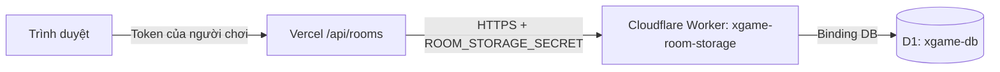

# Kết nối Vercel với Cloudflare D1

## Vì sao vừa tạo phòng đã báo hết hạn?

Bản cũ gọi `cloudflare:workers` để lấy binding D1, nhưng API đang chạy trên Vercel/Next.js. Khi truy cập D1 thất bại, code bỏ qua lỗi và lưu phòng trong `Map` của tiến trình. Request sau có thể chạy ở instance khác nên không tìm thấy phòng. Thông báo “không tồn tại hoặc đã hết hạn” không có nghĩa TTL thực sự đã hết.

Bản sửa giữ website trên Vercel và đưa dữ liệu vào D1 qua Worker riêng:



Trình duyệt không biết khóa truy cập Worker. Không cần chuyển domain, DNS hoặc frontend khỏi Vercel. Không cần API token quản trị Cloudflare trong Vercel. Worker chỉ nhận các thao tác lưu phòng định sẵn, không cung cấp endpoint thực thi SQL tùy ý.

Hướng dẫn dưới đây tạo tài nguyên **mới**. Chưa có tài khoản Cloudflare/Vercel được kết nối cho phiên làm việc này, nên tài nguyên và biến môi trường production chưa được tạo tự động.

## 1. Tạo D1 database

1. Đăng nhập [Cloudflare Dashboard](https://dash.cloudflare.com/).
2. Chọn account, mở **Storage & databases → D1 SQL Database** (có thể tìm “D1” trong dashboard).
3. Chọn **Create database**, đặt tên **xgame-db**.
4. Mở database vừa tạo → **Console**.
5. Copy toàn bộ [db/bootstrap.sql](../db/bootstrap.sql), dán vào console và chạy. File này tạo bảng `rooms` đủ 5 cột và index.
6. Kiểm tra bằng:

```sql
PRAGMA table_info(rooms);
```

Phải có `code`, `state`, `version`, `expires`, `token`.

Nếu tái sử dụng database cũ chỉ có 4 cột, chạy **một lần**, sau khi xác nhận đang thiếu `token`:

```sql
ALTER TABLE rooms ADD token TEXT NOT NULL DEFAULT '';
```

Không chạy ALTER này nếu cột đã tồn tại. `CREATE TABLE IF NOT EXISTS` không tự bổ sung cột vào bảng cũ.

## 2. Tạo Worker kết nối D1

1. Trong Cloudflare, mở **Workers & Pages → Create application** và tạo Worker dạng **Hello World** (tên nút có thể thay đổi).
2. Đặt tên **xgame-room-storage**, deploy bản khởi tạo.
3. Mở **Edit code**; thay toàn bộ mã mẫu bằng nội dung [worker/room-storage.mjs](../worker/room-storage.mjs). File tự chứa đầy đủ code, không cần npm install hoặc import file khác.
4. Lưu/deploy code mới.
5. Mở tab **Bindings → Add binding → D1 database**:
   - Variable name: **DB** — phải đúng chữ hoa.
   - D1 database: **xgame-db**.
6. Lưu binding và deploy thay đổi nếu dashboard yêu cầu.

Nguồn chính thức: [tạo D1 và binding](https://developers.cloudflare.com/d1/get-started/), [tạo Worker từ dashboard](https://developers.cloudflare.com/workers/get-started/dashboard/).

## 3. Đặt khóa bí mật cho Worker

Tạo một chuỗi ngẫu nhiên dài ít nhất 32 ký tự (khuyến nghị 64 ký tự), ví dụ bằng trình tạo mật khẩu. Không dùng tên phòng, mật khẩu cá nhân hoặc API key của tài khoản Cloudflare.

Trong Worker → **Settings → Variables and Secrets → Add**:

| Name | Type | Value |
| --- | --- | --- |
| `ROOM_STORAGE_SECRET` | Secret | Chuỗi ngẫu nhiên vừa tạo |

Lưu khóa trong trình quản lý mật khẩu để dùng cùng giá trị ở Vercel. Không dán khóa vào chat hoặc commit vào Git. Deploy lại Worker sau khi thêm secret nếu được yêu cầu. Xem [Cloudflare Worker secrets](https://developers.cloudflare.com/workers/configuration/secrets/).

Lấy địa chỉ production của Worker từ dashboard, ví dụ:

```text
https://xgame-room-storage.ten-account.workers.dev
```

Mở địa chỉ này trực tiếp trong trình duyệt và nhận **401 Unauthorized là bình thường**: trình duyệt không gửi khóa. Nếu 503 ngay cả khi mở trực tiếp, kiểm tra binding DB và secret ít nhất 32 ký tự. Không bật Cloudflare Access bắt đăng nhập cho URL này trừ khi bổ sung cơ chế service-token tương ứng vào code.

## 4. Kết nối Vercel

Mở project chứa `xgame-ivory.vercel.app` → **Settings → Environment Variables**. Thêm:

| Biến | Giá trị | Phạm vi |
| --- | --- | --- |
| `ROOM_STORAGE_URL` | URL production của Worker ở bước 3 | Production |
| `ROOM_STORAGE_SECRET` | **Giống chính xác** secret trên Worker | Production; chọn Secret/Sensitive nếu có |

Không đặt tiền tố `NEXT_PUBLIC_`. URL không có query, username hoặc password. Nếu muốn thử Preview, nên tạo database/Worker riêng và đặt hai biến tương ứng cho Preview, tránh trộn phòng test với production.

Sau đó:

1. Đưa bản code đã sửa trong workspace lên repository/nhánh Vercel đang deploy.
2. Tạo deployment mới hoặc **Deployments → Redeploy** sau khi code và environment variables đã cập nhật.
3. Đảm bảo deployment production mới có route `/api/rooms` từ bản sửa, không chỉ redeploy commit cũ.

Vercel chỉ áp dụng biến môi trường cho deployment mới: [Environment variables](https://vercel.com/docs/environment-variables).

`vercel.json` tiếp tục dùng framework Next.js; không cần thêm Cloudflare binding vào file này. File `.openai/hosting.json` phục vụ đường chạy Sites/Vinext, không kết nối database cho Vercel.

## 5. Xác minh kết nối

### Kiểm tra ở máy phát triển

Copy [.env.example](../.env.example) thành `.env.local`, điền URL/secret giống ở trên. File `.env.local` đã bị Git ignore. Chạy:

```sh
npm run db:check
```

Kết quả mong đợi:

```text
OK: Cloudflare Worker authentication, D1 binding and rooms schema are ready.
```

Lệnh kiểm tra xác thực, binding và đủ cột của bảng; không đọc dữ liệu người chơi ra màn hình, không tạo/xóa phòng. Thành công ở local chưa chứng minh Vercel đã có đúng biến môi trường: vẫn cần kiểm tra deployment dưới đây.

### Kiểm tra website đã deploy

1. Mở website, tạo phòng mới; giữ trang mở ít nhất 30 giây.
2. Mở hai cửa sổ/trình duyệt độc lập, tham gia bằng mã phòng; đủ 3 người thì bắt đầu.
3. Hoàn thành hai lượt gợi ý và bỏ phiếu. Kiểm tra mọi người nhìn thấy cùng kết quả.
4. Reload tab đang chơi để kiểm tra token trong sessionStorage vẫn truy cập được phòng.
5. Trong D1 Console, xác nhận bản ghi và version thay đổi, không hiển thị state/token:

```sql
SELECT code, version, expires FROM rooms;
```

Có thể chạy smoke test tự động:

```sh
node scripts/verify-room-api.mjs https://xgame-ivory.vercel.app/
```

Script tạo phòng test, kiểm tra nhiều lần đọc, 3 người vào/gửi gợi ý/bầu đồng thời, kết quả và quyền nhìn thấy; cuối cùng tự rời phòng. Nếu mạng lỗi giữa chừng, có thể cần dọn phòng test còn sót. Script không in token.

Phòng cũ chỉ lưu RAM không được khôi phục tự động; sau khi deploy bản sửa, tạo phòng mới. Điểm mới nằm trong state của phòng D1 và không mất khi Vercel đổi instance/redeploy; khi mọi người chủ động rời hết, phòng bị xóa theo luật hiện hành.

## 6. Nếu muốn dùng CLI thay dashboard

Repository có sẵn Wrangler. Đăng nhập Cloudflare và tạo database:

```sh
npx wrangler login
npx wrangler d1 create xgame-db
```

Điền Database ID trả về vào `database_id` trong [wrangler.jsonc](../wrangler.jsonc). Sau đó:

```sh
npm run db:migrate:remote
npm run storage:deploy
npm run storage:secret
```

Lệnh cuối hỏi secret qua prompt; dùng cùng giá trị ở Vercel. Cấu hình CLI vẫn còn placeholder cho đến khi bạn điền Database ID. Không cần điền ID nếu chỉ làm hoàn toàn qua dashboard.

**Chọn một cách khởi tạo schema:** migrations CLI cho database mới, hoặc bootstrap SQL qua console. Nếu đã bootstrap qua dashboard rồi, không chạy lại migrations tạo bảng trên cùng database mà chưa đồng bộ lịch sử migration. CLI `migrations apply` tự ghi lịch sử riêng; bootstrap console không ghi lịch sử đó.

## 6.1. Deploy qua Git / Cloudflare Workers Builds

Nếu Cloudflare clone repository và tự chạy build/deploy, vào Worker **xgame → Settings → Build** và sửa:

| Thiết lập | Giá trị |
| --- | --- |
| Root directory | Thư mục gốc repository, nơi có package.json |
| Build command | `npm run storage:build` |
| Deploy command | `npm run storage:deploy` |
| Worker name | `xgame`, khớp `name` trong wrangler.jsonc |

Build chỉ kiểm tra cú pháp Worker; Wrangler sẽ bundle khi deploy. Vercel vẫn giữ `npm run build` cho website. Nếu bật build nhánh không phải production, tắt trong lần cấu hình đầu hoặc cấu hình lệnh upload riêng cũng chỉ rõ `--config wrangler.jsonc`; không để lệnh Wrangler tự dò framework.

Trước khi retry:

1. Đảm bảo commit trên Git có `worker/room-storage.mjs`, `wrangler.jsonc` và scripts `storage:*` trong package.json.
2. Trong D1 database → Settings, copy **Database ID** thay `REPLACE_WITH_YOUR_D1_DATABASE_ID` trong wrangler.jsonc; commit thay đổi. Đây là ID tài nguyên, không phải secret.
3. Đảm bảo bảng rooms đã được tạo theo bước 1; đặt secret trong **Worker runtime Settings → Variables and Secrets**, không chỉ trong Build variables.
4. Push code rồi retry build. Worker URL sẽ có dạng `https://xgame.<subdomain>.workers.dev`; dùng URL thực tế này cho `ROOM_STORAGE_URL` trên Vercel.

Nếu Worker dashboard của bạn có tên khác, sửa `name` trong file config cho khớp. File hiện dùng `xgame` theo log build ngày 13/11/2026; tên `xgame-room-storage` trong ví dụ dashboard ở trên chỉ là tên gợi ý khi tạo mới.

**Lỗi ERESOLVE trong log đã gửi:** `next build` đã thành công. Bản cũ đặt cấu hình tên `wrangler.storage.jsonc`, nên lệnh `npx wrangler deploy` không tự tìm được file này và chạy OpenNext migrate. Bước tự thiết lập cố cài Wrangler 4.161.0, yêu cầu workers-types v5, trong khi dự án khóa workers-types v4. Bản sửa đổi tên thành **`wrangler.jsonc` ở gốc repository**, giữ nguyên Database ID đã điền. Vì vậy lệnh mặc định cũng tìm đúng `worker/room-storage.mjs`; không cần `--force`, `--legacy-peer-deps` hoặc nâng dependency.

Nếu log vẫn hiện `@opennextjs/cloudflare migrate` sau bản sửa, kiểm tra SHA commit của build và Root directory: deployment phải dùng commit có `wrangler.jsonc` và chạy tại thư mục chứa file này. Chạy lại deployment cũ không tự đưa code mới vào. Khi đổi config tên file, cập nhật mọi lệnh dashboard còn ghi `--config wrangler.storage.jsonc` sang `--config wrangler.jsonc` hoặc dùng `npm run storage:deploy`.

Lệnh tương đương nếu muốn nhập trực tiếp vào ô Deploy command:

```sh
npx wrangler deploy --config wrangler.jsonc
```

Nguồn: [Cloudflare Workers Builds configuration](https://developers.cloudflare.com/workers/ci-cd/builds/configuration/).

## 7. Chẩn đoán nhanh

| Hiện tượng | Cần kiểm tra |
| --- | --- |
| Deploy tự chạy OpenNext rồi ERESOLVE | Sửa Build/Deploy commands theo mục 6.1; deploy phải chỉ rõ config storage |
| Worker name mismatch / database ID không hợp lệ | `name` phải khớp Worker dashboard; thay Database ID placeholder |
| “Chưa cấu hình lưu phòng Cloudflare” | Hai env trên Vercel và deployment mới |
| “Kết nối Cloudflare bị từ chối” | Secret hai nơi phải khớp; Worker có Access/WAF chặn không |
| “Worker/binding/bảng chưa sẵn sàng” | Binding đúng tên DB; bảng rooms đủ cột, nhất là token |
| “Không kết nối được” | URL đúng HTTPS, Worker đang deploy, kiểm tra quota/log Cloudflare |
| Tạo được nhưng vẫn 404 ngay | Kiểm tra đang dùng commit mới; mọi instance/deployment trỏ cùng Worker/database; không còn RAM fallback production |
| Thỉnh thoảng “Phòng đang cập nhật” | Xung đột version sau 8 lần thử; kiểm tra tải và log |
| Build xong nhưng không dùng D1 | Không dùng `.openai/hosting.json` để cấu hình Vercel; cần hai env kể trên |

Production thiếu DB hoặc DB lỗi sẽ trả **503**, không tạo phòng RAM rồi giả báo thành công. Dev không có hai env vẫn dùng RAM để chạy thử; `npm start` là production nên cũng yêu cầu storage thật.

## 8. Phạm vi bản sửa và giới hạn

- Một nguồn lưu duy nhất cho mỗi request: Worker/D1, native D1 khi chạy toàn bộ app trên Cloudflare, hoặc RAM chỉ ở dev.
- INSERT không ghi đè phòng trùng mã; UPDATE/DELETE kiểm tra version trong cùng câu SQL; update tăng version.
- Worker dùng primary cho lần đọc đầu của D1 session để tránh đọc trạng thái cũ nếu bật read replication.
- Không tự retry khi ghi bị timeout vì request có thể đã hoàn tất; client có thể tải lại phòng để đồng bộ.
- Mã phòng luôn đủ 5 ký tự hợp lệ; không còn lỗi index 31 của alphabet 31 ký tự.
- TTL và hành vi giữ phòng đang có người giữ nguyên; đóng tab chưa tự rời phòng, chưa bổ sung cron dọn phòng hoặc lịch sử điểm dài hạn.
- Game vẫn polling 1,6 giây, nên lưu lượng D1/Worker tăng theo số người. Gateway dùng D1 binding thay API quản trị Cloudflare; vẫn chịu quota của gói Worker/D1 đang dùng. Xem [D1 limits](https://developers.cloudflare.com/d1/platform/limits/) khi triển khai nhiều phòng.

Kiểm thử tự động dùng SQLite cục bộ mô phỏng binding và request Worker; cần hoàn tất bước 5 với tài khoản thật để xác nhận kết nối production.
